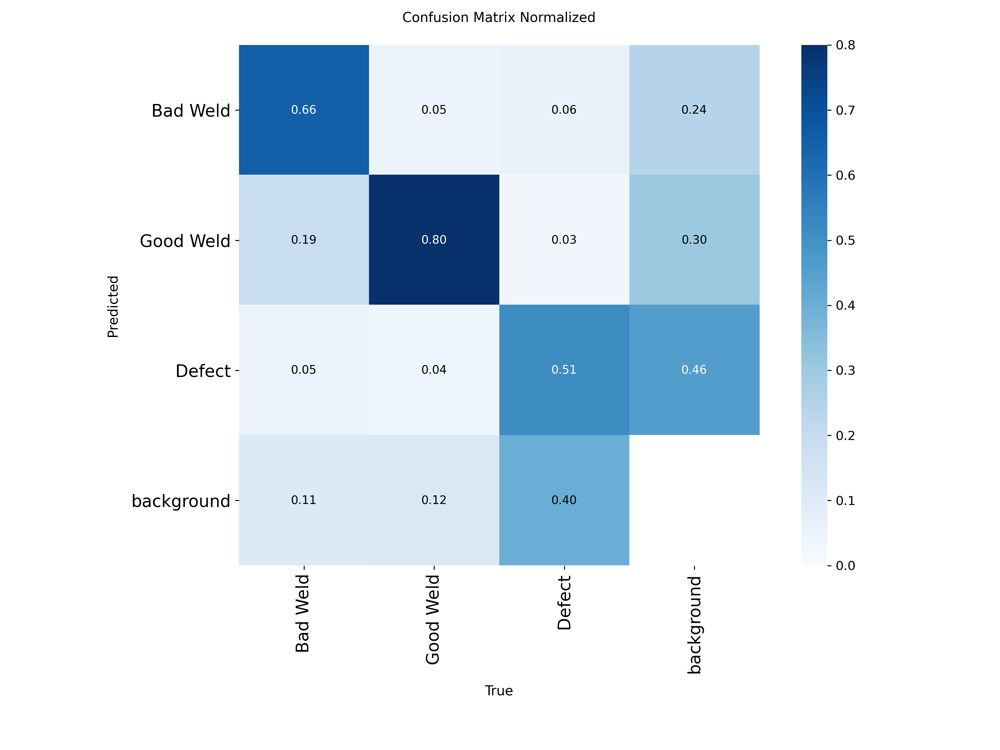

# Assignment 2 Report

- **Name**: Wilrick Qirui Ralph Dong 
- **Student ID**: 20426
- **Email**: wdong.ieu2022@student.ie.edu
- **Group**: BBADBA 5A 

## Business problem, and the cost of being wrong

Chispa Componentes S.L. is a Tier-1 automotive supplier in Getafe that welds steel rear subframes (the structure that holds the rear suspension and bolts to the car body) for a European carmaker’s best-selling SUV. A failed weld here is a safety issue. Right now, inspectors check every critical weld seam by hand, and the quality team has become the bottleneck. The plant manager wants a camera-plus-ML system that flags suspicious welds so inspectors only check those.
>

The model supports one decision per weld photo on Chispa Componentes' rear-subframe line: should this critical seam continue down the line, go to rework, or get a human check? The camera photographs each of the 10 critical seams per subframe (8,000 photos a day), and the model's highest defect confidence for the photo determines the route.

| Outcome | What happens | Who acts | Cost if the call is wrong |
|---|---|---|---|
| **Pass** (score below the low threshold) | The subframe continues automatically to the next station and the end-of-line check | No one; nobody looks at this seam again before it ships | €2,000 expected cost of an escaped bad weld (FN) |
| **Fail** (score at or above the high threshold) | The conveyor diverts the subframe to the rework station | A rework welder grinds out and re-welds the seam, then re-inspects it; about 10% of real defects can't be repaired and the subframe is scrapped | €25 for a needless rework of a good weld (FP) |
| **Send to an inspector** (score between the thresholds) | The subframe goes to the inspection bay | A certified weld inspector spends ~60 s (€0.53) checking the seam and makes the final pass/fail call; if they fail it, it goes to rework | The inspector misses 10% of bad welds and fails 2% of good ones |

The quality manager owns the operating point (the two thresholds) and is accountable for escapes. The shift supervisor staffs inspectors to match: the wider the "send to an inspector" band, the more checks per day, and each inspector covers about 390 checks (6.5 productive hours ÷ 60 s).

>

**False negative (bad weld passed).** The defective seam leaves the station unnoticed. About 80% of the time the end-of-line check catches it and we scrap a finished subframe (~€250). About 19% of the time it reaches the carmaker's plant, which means a chargeback, containment sorting of our stock and a formal 8D report (~€3,000). About 1% of the time it ends up in a car on the road, where we pay our share of warranty or recall costs (~€100,000). The expected cost is about €2,000 per miss.

**False positive (good weld failed).** The subframe goes to the rework station, where a welder re-checks the seam and usually re-welds it as a precaution. The cost is about €25 in handling and labour, and the problem never leaves the plant.

**Which is worse.** A miss costs about 80× more than a false alarm (€2,000 vs €25). Strictly, the relevant comparison is the extra cost of each mistake over the correct call. Missing a bad weld costs €1,950 more than catching it (€2,000 vs €50 rework). Failing a good weld costs €25 more than passing it (€25 vs €0). That ratio is about 78×.

A miss is worse for three reasons:
1. **Costs grow the further a defect travels.** A false alarm is fixed on our own floor in minutes; a miss gets more expensive at every step towards the customer.
2. **Safety.** The subframe holds the rear suspension, so a weld failure in service could cause an accident. That is a risk we can't fully price.
3. **The customer relationship.** Repeated escapes can put us on the carmaker's watch list or cost us the contract.

**Why we can't just fail everything.** Only 1% of welds are bad, so for every bad weld there are 99 good ones. Failing every weld would cost about €202,000 a day in needless rework (7,920 good welds × €25 + 80 bad × €50). That is worse than passing everything (80 misses × €2,000 = €160,000). The 80× cost gap pushes the threshold towards catching defects, but the low base rate pushes back, because even a small false-alarm rate on 7,920 good welds adds up fast. Break-even: failing a weld is worth it when the chance it is bad exceeds about 25 / (25 + 1,950) ≈ 1.3%.

## Dataset

- **Roboflow Universe**: workspace `defect-detection-fxtd5`, project `weld-defect-lze1x`, version `1`
- **Link**: https://universe.roboflow.com/defect-detection-fxtd5/weld-defect-lze1x
- **Task**: object detection, 3 classes. The export names them `0`, `1`, `2`; mapped in `config.py` to `0 = Bad Weld`, `1 = Good Weld`, `2 = Defect`.
- **Decision unit**: one photo = one case. A photo is "bad" if it contains at least one Bad Weld or Defect box.

Each image is a photo of welded metal parts, and a photo often shows several welds: across the 838 images there are 3,137 labelled boxes, about 3.7 per photo. Whole weld seams are boxed as either Bad Weld or Good Weld, and Defect boxes mark small, specific flaws on a seam.

The dataset exports its classes only as 0, 1 and 2, so I had to work out which is which before training. I drew the labelled boxes on six training photos, coloured by class number, and they matched: 0 sat on seams that looked uneven or messy, 1 on smooth, regular seams, and 2 on small spots on a seam. The box sizes agree. In the test split, class 0 boxes are the largest (median 5.0% of the image), class 1 next (2.7%) and class 2 the smallest (1.3%), which fits small local flaws. After training, a clean-looking weld I uploaded to the dashboard came back as Good Weld (0.54). So I mapped 0 = Bad Weld, 1 = Good Weld, 2 = Defect.

This dataset fits Chispa's problem because it labels exactly the decision Chispa needs to make: whether a weld is good or bad. The photos show many different types of welds rather than one fixed setup, but in each one a good weld and a bad weld can easily be told apart, so a model has a real difference to learn. That is why I think it can work for this use case.

## What the dataset's composition implies

| Split | Images | Photos with a bad weld or defect | Photos with only good welds | Bad Weld boxes | Good Weld boxes | Defect boxes |
|---|---|---|---|---|---|---|
| Train | 586 | 457 | 129 | 536 | 764 | 962 |
| Validation | 168 | 114 | 54 | 134 | 235 | 225 |
| Test | 84 | 58 | 26 | 64 | 110 | 107 |

Median box size as a share of the whole image (test split): Bad Weld 5.0%, Good Weld 2.7%, Defect 1.3%.

I think these numbers are large enough to trust. The false-alarm rate rests on the 26 test photos that contain only good welds, and I consider that enough because [your reason].

Most photos in this dataset contain a bad weld: 58 of the 84 test photos (69%), while on Chispa's real line I expect only 1%. My worry is that a model that has mostly seen bad welds gets used to finding them and flags too many good welds. I hope that is not the case. The cost calculation does not use the test set's mix. It measures how the model handles bad photos and good photos separately, then weights those results by the 1% / 99% split I assume for the real line.

Defect boxes are small, about 1.3% of the image, or roughly 73 × 73 pixels in a 640-pixel photo. I still think defects are easy to find because [your reason]. In the results, Defect has the lowest AP50 (0.48) and 43 of the 107 test defects were missed, which [your explanation].

What I can't conclude from these results is how the model will behave on Chispa's real line, where almost every weld is good, because it was mostly tested on photos with bad welds.
## Finetuning and baselines

**Training**: `yolo11n.pt` (COCO-pretrained), finetuned for detection on Google Colab (T4 GPU). Up to 60 epochs with early stopping (patience 20), image size 640, batch 16, seed 0. Took about 10 minutes. Best weights in `weights/best.pt`.

All three on the same test split (84 photos):

| Model | mAP50 | mAP50-95 | ROC AUC, bad vs good photo | Cost per 1,000 welds at its best threshold |
|---|---|---|---|---|
| Finetuned yolo11n | 0.690 | 0.413 | 0.883 | €7,783 |
| COCO yolo11n, zero-shot (any box counted as a defect) | 0.000 | 0.000 | 0.460 | €18,935 |
| Predict nothing (pass every weld) | 0.000 | 0.000 | 0.500 | €20,000 |

I used object detection because the dataset came with bounding boxes, so detection was the natural fit. I chose yolo11n, the smallest YOLO11 model, because it is fast to train and fast to run, which matters on a production line.

The COCO model scores zero on mAP because none of its 80 classes (person, car, dog and so on) is a weld or a defect, so it can never predict the right class. To still compare it on the actual decision, I counted any box it drew as a possible defect. On that test its AUC is 0.46: a bad photo scores higher than a good one only 46% of the time, which is no better than a coin flip. The pretrained model on its own cannot tell bad welds from good ones.

Finetuning made a large difference. mAP50 went from 0 to 0.69, the AUC from 0.46 to 0.88, and the expected cost of the model deciding alone fell from €18,935 to €7,783 per 1,000 welds. That gap is about what I expected.

## Per-class evaluation and failure modes

| Class | Precision | Recall | AP50 | AP50-95 |
|---|---|---|---|---|
| Bad Weld | 0.666 | 0.797 | 0.785 | 0.491 |
| Good Weld | 0.672 | 0.819 | 0.808 | 0.515 |
| Defect | 0.542 | 0.542 | 0.477 | 0.234 |

Confusion matrix on the test split (counts, boxes at confidence ≥ 0.25). Columns are the true class, rows what the model predicted:

| Predicted ↓ / True → | Bad Weld | Good Weld | Defect | Background |
|---|---|---|---|---|
| **Bad Weld** | 42 | 5 | 6 | 23 |
| **Good Weld** | 12 | 88 | 3 | 29 |
| **Defect** | 3 | 4 | 55 | 44 |
| **Background (missed)** | 7 | 13 | 43 | – |

Good Weld (AP50 0.81) and Bad Weld (0.78) carry the headline number. Defect drags it down: its AP50 is 0.48, with precision and recall both around 0.54.

Of the 64 true bad welds in the test set, the model labelled 42 correctly. Of the other 22, it labelled 12 as Good Weld and 3 as Defect, and missed 7 completely. The expensive mistake for Chispa is the 12 bad welds labelled Good Weld, because a weld the model thinks is good can pass, and a missed bad weld costs €2,000.

Of the 107 true defects, the model found 55. It missed 43 completely, and labelled 6 as Bad Weld and 3 as Good Weld. It also drew 44 defect boxes where nothing was labelled. I think the main reason is that defects are tiny, about 1.3% of the image, so they are easy to overlook.

Defect boxes are small, about 1.3% of the image, or roughly 73 × 73 pixels in a 640-pixel photo, which makes them easy to overlook. This shows in the results: Defect has the lowest AP50 (0.48) and 43 of the 107 test defects were missed.

## Cost matrix and operating point

| | Cost per case | Why this figure |
|---|---|---|
| Missed bad weld (FN) | €2,000 | ✏️ |
| Good weld sent to rework (FP) | €25 | ✏️ |
| Bad weld correctly failed (TP) | €50 | ✏️ |
| Good weld correctly passed (TN) | €0 | ✏️ |
| One inspector check | €0.53 (60 s at €32/h) | ✏️ |
| Production base rate | 1% (80 bad welds a day out of 8,000) | ✏️ |

Model-alone cost across thresholds (pass below, fail at or above), per 1,000 welds:

| Threshold | 0.05 | 0.10 | 0.20 | 0.30 | **0.37** | 0.50 | 0.70 |
|---|---|---|---|---|---|---|---|
| Cost (€) | 13,547 | 12,595 | 11,085 | 8,678 | **7,783** | 10,473 | 13,948 |
| Bad welds caught | 97% | 97% | 90% | 78% | 72% | 59% | 31% |
| Good welds sent to rework | 50% | 46% | 35% | 15% | 8% | 8% | 0% |

The cheapest model-alone threshold is **0.37**. Full curve: dashboard tab "Cost against threshold" and `results/cost_sweep.csv`.

How the best threshold moves if the base rate or the cost of a miss is wrong (from `results/sensitivity.csv`):

| Base rate ↓ / Cost of a miss → | €500 | €1,000 | €2,000 | €4,000 | €8,000 |
|---|---|---|---|---|---|
| 1% | 0.69 | 0.37 | **0.37** | 0.13 | 0.13 |
| 2% | 0.37 | 0.37 | 0.13 | 0.13 | 0.02 |
| 5% | 0.37 | 0.13 | 0.13 | 0.02 | 0.02 |
| 10% | 0.13 | 0.13 | 0.02 | 0.02 | 0.00 |

I choose the model + inspector band: welds scoring below 0.02 pass, welds at 0.69 or above go to rework, and everything in between goes to an inspector. I chose it because it lets the fewest bad welds escape, which matters most on a safety-critical part like a subframe. With my assumptions, about 6.6 bad welds a day would get through, compared with 8 if inspectors checked every weld, 22 with the model alone and 80 with no inspection.

I assumed a missed bad weld costs €2,000 because that is the expected cost of an escape (about €1,770 from end-of-line scrap, carmaker chargebacks and the occasional warranty or recall case), rounded up for the risk of losing the contract. The answer changes if this cost rises above about €3,000: then almost every weld (99.7%) should go to an inspector. If it drops below about €575, more welds pass automatically and only 39% go to an inspector.

## What a person still has to check

Review band from the cost sweep: **pass below 0.02, fail at or above 0.69, inspector in between.**

| Strategy | Cost per day | Sent to an inspector | Checks per day | Inspectors needed (6.5 productive h each) |
|---|---|---|---|---|
| Do nothing (pass every weld) | €160,000 | 0% | 0 | 0 |
| An inspector checks every weld | €27,827 | 100% | 8,000 | 20.5 |
| Model alone (threshold 0.37) | €62,265 | 0% | 0 | 0 |
| Model + inspector band (0.02–0.69) | €21,345 | 54% | 4,317 | 11.1 |

Every weld photo gets a score: the model's highest confidence that it contains a bad weld or a defect. If the score is below 0.02, the model is confident the weld is fine and it passes. If the score is 0.69 or above, the model is confident something is wrong and the part goes straight to the rework station. Anything in between goes to an inspector, who checks it by hand and decides.

The band sends 54% of welds to an inspector: about 4,317 checks a day. At 60 seconds each, that is about 72 hours of checking a day, or 11 inspectors at 6.5 productive hours each. Checking every weld by hand, as Chispa does today, takes 8,000 checks: about 133 hours, or 20.5 inspectors. So the band needs about half of today's team. I think that is realistic, but only after a trial period.

The model on its own loses because the welds with unsure scores are where its mistakes happen. With the band, those welds go to an inspector, who catches most of them, while the model still decides the clear cases. That is why about 22 bad welds a day get through with the model alone, but only about 6.6 with the model and inspectors together.

I would ship it with the cost-optimal band, but not switch over straight away. First I would run the model alongside today's inspectors, who keep checking every weld, and compare its decisions with theirs before reducing the team.

## Limitations & next steps

Defects are tiny and often missed. A Defect box covers about 1.3% of the image, roughly 73 × 73 pixels in a 640-pixel photo, and the model missed 43 of the 107 defects in the test set. To fix this, I would train at a higher image resolution (for example 1024 pixels instead of 640) or use a bigger model such as yolo11s.

The test set does not look like the real line. Only 26 of the 84 test photos contain only good welds, and 69% contain a bad weld, while I expect 1% on Chispa's line. So the false-alarm rate and the costs rest on very few good-weld photos. To fix this, I would replace it with Chispa's real data: test the model on photos from the actual line during the trial run, where almost every weld is good and the inspectors' decisions can serve as labels.

The dataset photos don't look like Chispa's line. They show many different parts and types of welds, while Chispa's cameras would photograph the same subframe seams every day. To fix this, I would collect and label photos from Chispa's own cameras and finetune the model on them.

Where it does not match: the photos show many different parts and types of welds, while a camera on Chispa's line would photograph the same subframe seams every day.

The false-alarm rate rests on only 26 test photos that contain only good welds, so it is too thin to fully trust: one photo more or less changes it by about 4 percentage points.

## Generative AI use disclosure

- **Claude (Anthropic)** suggested candidate industries and Roboflow datasets. I chose this one.
- **Claude** wrote the code: `train.py`, `app.py`, `decision.py`, and the structure of `config.py`. It also fixed the class-name mapping for this dataset version and a display bug.
- **Claude** laid out this report: the section structure and the tables, filled from `results/`.

